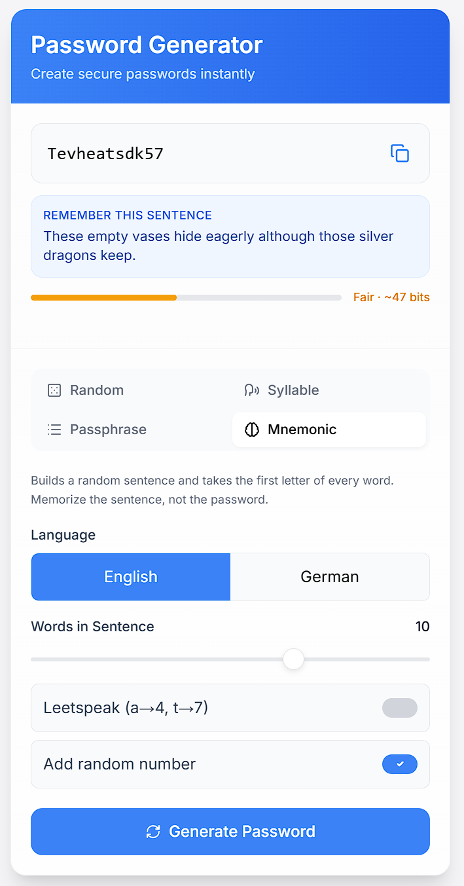

#  Secure Password Generator

A modern, responsive web application for generating secure passwords and passphrases with customizable options. Runs entirely in the browser, works offline, and loads no third-party code at runtime.



## Features

- **Three Generation Modes**:
  - Random: Fully random characters with customizable character sets
  - Syllable: Pronounceable passwords using syllable patterns
  - Passphrase: Memorable word combinations from a 7776-word Diceware list

- **Customization Options**:
  - Adjustable password length (6-64 characters)
  - Toggle character types (uppercase, lowercase, numbers, symbols)
  - Multiple languages for passphrases (English, German)
  - Word count (3-12) and separator options for passphrases
  - Option to add a random number to passphrases

- **Security**:
  - All randomness comes from `crypto.getRandomValues()`
  - Uniform selection via rejection sampling (no modulo bias)
  - Live entropy estimate for every generated password
  - No network requests after load, no analytics, nothing leaves the device

- **User Experience**:
  - Clean, iOS-inspired UI with smooth animations
  - One-click copy to clipboard with visual feedback
  - Responsive design works on all device sizes
  - Installable PWA that works fully offline

## Security notes

The generator's strength comes from the *process*, not from how scrambled the
output looks. Every choice - each character, each word, each capitalisation -
is drawn from `crypto.getRandomValues()` using rejection sampling, so all
outcomes are equally likely.

The strength bar shows the entropy of that process: the work required by an
attacker who knows this exact algorithm and every setting you picked. Rough
guide: below 40 bits is weak, 60-80 bits is solid for most accounts, and 80+
bits is appropriate for a password manager's master password.

| Setting | Entropy |
| --- | --- |
| Random, 16 chars, all four character types | ~103 bits |
| Random, 16 chars, lowercase only | ~75 bits |
| Passphrase, 6 words | ~78 bits |
| Passphrase, 4 words | ~52 bits |
| Random, 8 chars, all four character types | ~52 bits |

Two caveats worth knowing:

- **Syllable mode trades strength for pronounceability.** Its estimate is a
  model of the generator (pattern mix, capitalisation, substitutions), not an
  exact count, and it does not account for the small amount of structure that
  makes the output pronounceable in the first place. Treat it as approximate
  and slightly optimistic.
- **Adding a number to a passphrase adds only ~6.5 bits.** Adding one more
  word adds ~12.9 bits, and is easier to remember.

## Technologies Used

- HTML5, CSS3, JavaScript (ES2017)
- [Tailwind CSS](https://tailwindcss.com/) - compiled at build time into a
  single stylesheet, not loaded from a CDN
- [Inter Font](https://rsms.me/inter/) - self-hosted subset
- [Lucide Icons](https://lucide.dev/) - inlined as SVG, no runtime library
- Modern CSS features like backdrop-filter for the frosted glass effect

## How to Use

1. Open the app (or `index.html` through a local web server - see below)
2. Select your preferred generation mode (Random/Syllable/Passphrase)
3. Adjust the settings to your preference
4. Click "Generate Password" to create a new password
5. Click the copy icon to copy the password to clipboard

## Development

The stylesheet is generated, so it needs one build step:

```bash
npm install         # once
npm run build:css   # writes assets/app.css
npm run watch:css   # or rebuild on change while developing
```

Then serve the folder over HTTP - opening `index.html` via `file://` will not
work, because service workers and `fetch()` for the word lists both require a
real origin:

```bash
python3 -m http.server 8000
# http://localhost:8000
```

`assets/app.css` is committed so the app also works when checked out without a
build, but re-run `npm run build:css` after changing any class in
`index.html` or anything in `src/app.css`.

To regenerate the PWA icons from `logo.png` (requires Pillow):

```bash
python3 script/gen.py
```

## Deployment

Pushing to `main` runs `.github/workflows/deploy.yml`, which builds the CSS,
assembles the browser-facing files into `_site/`, checks that every asset the
service worker precaches actually exists, and publishes to the `gh-pages`
branch. The build config, `node_modules` and the 1.5 MB `logo.png` icon source
stay out of the published site.

All paths in `index.html`, `manifest.json` and `sw.js` are relative, so the app
works both at a domain root and under a sub-path such as
`https://user.github.io/pwgen/`.

## Browser Support

The application works in all modern browsers including Chrome, Firefox, Safari
and Edge. It requires the Web Crypto API and refuses to generate a password
without it, rather than silently falling back to a weaker source of randomness.

## Credits

- English word list: [EFF Long Wordlist](https://www.eff.org/deeplinks/2016/07/new-wordlists-random-passphrases)
  by the Electronic Frontier Foundation, licensed
  [CC BY 3.0 US](https://creativecommons.org/licenses/by/3.0/us/).
- German word list: [dys2p/wordlists-de](https://github.com/dys2p/wordlists-de)
  (`de-7776-v1-diceware`), multi-licensed under Unlicense, CC0 and BSD-3.

## License

This project is open source and available under the [MIT License](LICENSE).

## Contributing

Contributions are welcome! Please open an issue or submit a pull request for any improvements.
